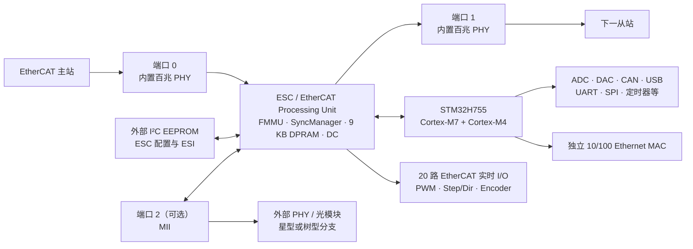

---
tags:
  - EtherCAT
  - 芯片
  - ASIX
  - AX58400
created: 2026-11-24
source_checked: 2026-11-24
aliases:
  - AX58400
  - AX58400BI
  - EtherCAT从站双核微控制器
---

# AX58400：EtherCAT 从站双核微控制器

> **一句话定位：** AX58400 把 STM32H755 双核 MCU、EtherCAT 从站控制器和两路百兆 PHY 封装进一颗 13 mm × 13 mm 的 SiP，适合需要“实时通信 + 较复杂控制算法”的 EtherCAT 从站产品。
>
> 官方产品页：[ASIX AX58400](https://www.asix.com.tw/cn/product/IndustrialEthernet/EtherCAT/AX58400)

## 先给结论

AX58400 不是“普通 MCU + 外挂 ESC”的开发板级组合，也不是只有现场总线功能的单核通信 SoC。它的核心价值是把两类资源放进同一封装：

1. **网络与实时数据交换**：ESC、2 路内置百兆 PHY、可选第 3 路 MII、FMMU、SyncManager、9 KB DPRAM、64 位 DC。
2. **应用计算与控制**：480 MHz Cortex-M7、240 MHz Cortex-M4、2 MB Flash、1 MB SRAM，以及 ADC、DAC、CAN、USB、定时器等外设。

因此，它更适合伺服/运动控制、机器人关节、复杂 I/O、EtherCAT 网关和带 HMI 的工业节点；如果只需要少量 I/O，AX58400 往往明显性能过剩。

## 1. 芯片内部怎么分工

可以把它分成三层理解：

| 层次 | 主要组成 | 主要职责 | 设计关注点 |
|---|---|---|---|
| EtherCAT 网络层 | ESC、PHY、MII、DPRAM、FMMU、SM、DC | 接收并转发 EtherCAT 帧、映射过程数据、提供同步时钟 | 拓扑、PHY/变压器、EEPROM、DC 配置 |
| 控制计算层 | M7、M4、Flash、SRAM、DMA | 运行 SSC 协议栈、控制算法、网关和诊断程序 | 双核任务划分、缓存一致性、实时响应 |
| 应用 I/O 层 | ADC/DAC、PWM、编码器、CAN、标准以太网 MAC 等 | 连接传感器、执行器、上位系统或辅助网络 | 时钟、接口冲突、隔离与 EMC |

## 2. AX58400 处理 EtherCAT 数据的过程

1. 主站发出一个或多个 EtherCAT 子报文，报文沿主站配置的网络拓扑经过各从站。
2. 报文到达 AX58400 的端口 0/1/2 后，ESC 的硬件处理单元直接读取、写入或转发，不需要 Cortex-M7/M4 逐帧参与。
3. **FMMU** 把报文中的逻辑地址映射到 ESC 内部物理存储区；**SyncManager** 管理数据缓冲区、访问一致性和主站/本机固件之间的数据交接。
4. 固件从过程数据区读取输出命令，执行控制算法，再把反馈、状态和输入数据写回相应缓冲区。
5. CoE、FoE、VoE 等应用层协议并不是由 ESC 单独完成的；设备端的邮箱协议、对象字典和状态机通常由 MCU 中的 EtherCAT SSC 协议栈配合实现。

需要区分两个时间概念：

- **报文转发快**：厂商给出的典型转发延迟小于 1 μs，指的是 ESC 对经过的帧进行处理/转发的硬件路径。
- **应用响应准**：最终控制周期是否稳定，还取决于 DC 配置、SYNC0/1、固件调度、数据拷贝、控制算法耗时和外部器件延迟。

二者不能画等号。ESC 转发得快，不代表一个未做实时设计的 MCU 应用也能获得相同的周期稳定性。

## 3. 关键规格

| 项目 | 规格 | 解读 |
|---|---|---|
| 产品形态 | System-in-Package（SiP） | 一颗封装内包含 STM32H755 类 MCU 子系统与 ASIX ESC 子系统，可减少外部总线、器件和布线 |
| CPU | Cortex-M7 480 MHz、Cortex-M4 240 MHz | M7 适合浮点/DSP 和控制算法；M4 可承担通信、网关、辅助 I/O 等任务 |
| 存储 | 2 MB 双 Bank Flash、1 MB SRAM | 双 Bank 便于 Bootloader、读写并行和可靠升级设计；SRAM 中含 192 KB TCM |
| EtherCAT 端口 | 2/3 端口 ESC | 端口 0、1 内置 PHY；端口 2 是可选 MII |
| ESC RAM | 9 KB | 存放 ESC 过程数据和寄存器资源，不能当成普通应用 RAM |
| FMMU / SM | 8 个 FMMU、8 个 SyncManager | 支持复杂的逻辑地址映射和多条过程数据/邮箱通道 |
| 分布式时钟 | 64 位 DC | 提供网络时间基准、SYNC/LATCH、事件时间戳等能力 |
| 外部配置存储 | I²C EEPROM，1 Kbit 至 4 Mbit | 保存 ESC 配置、ESI 和硬件配置；上电复位后自动加载 |
| ESC 参考时钟 | 25 MHz 晶振，室温 ±25 ppm | 直接影响 DC 时间质量和同步稳定性，应按官方要求选型 |
| 实时控制资源 | 3 路 PWM、Step/Dir、增量/Hall 编码器、SPI Master、I/O Watchdog、20 路直接 I/O | 可在 ESC 一侧完成简单实时动作，减少 MCU 调度延迟 |
| 普通以太网 | MCU 自带 1 路 10/100 MAC，支持 MII/RMII 和 IEEE 1588 | 与 EtherCAT ESC 是两套网络资源，可用于辅助以太网或网关 |
| 其他接口 | USB OTG、CAN FD/TT-CAN、UART、SPI、I²C、SAI、SDMMC、ADC、DAC 等 | 适合把驱动器、传感器、显示和上层网络集成到一个节点 |
| 安全 | AES/TDES/HASH/HMAC、ROP/PCROP、主动防篡改、TRNG、唯一 ID | 可用于固件保护、密钥处理和产品身份管理 |
| 封装/温度 | 225-ball TFBGA，13 mm × 13 mm，0.8 mm 间距，-40～85 °C | 工业级温度，但 BGA 对电源完整性、回流和 PCB 工艺要求较高 |

## 4. ESC 里的几个关键部件

### FMMU：逻辑地址怎么落到本机存储

主站通常按 EtherCAT 逻辑地址组织数据。FMMU 负责把一段逻辑地址映射到 ESC 内的物理地址，并支持位级偏移。应用固件只面对固定的过程数据位置，不必解析每一个经过的以太网帧。

### SyncManager：主站和本机怎么安全交接数据

SyncManager 把 ESC 内存划分成可受控访问的缓冲区，管理读、写方向与一致性。循环过程数据、邮箱输入和邮箱输出通常经过不同的 SyncManager 通道。它解决的是“谁在什么时候可以访问哪段缓冲区”，而不是地址转换。

### DPRAM：网络数据和应用数据的交汇点

9 KB DPRAM 是 ESC 的受限实时内存，不属于 STM32 的大容量 SRAM。应用代码需要通过规定的 PDI/桥接机制和内存映射访问它，不能简单把指针当成普通全局数组使用。

### 64 位 DC：不是普通 RTC

DC 提供跨越整个 EtherCAT 网络的时间基准，并产生 SYNC0/1 输出、LATCH0/1 输入和相关事件时间戳。对伺服驱动、同步采样和多轴协同，DC 可以成为控制周期的节拍源。

但 DC 不会自动让 MCU 控制环节变准。还需要：

- 正确选择参考时钟和主站 DC 模式。
- 把 SYNC0 或 LATCH 信号连接到定时器/中断/ESC 内部动作。
- 避免中断抖动、DMA 排队和缓存操作吞掉同步余量。
- 对环回、启动过程和每个节点检查 DC 偏差。

## 5. ESC 自带的实时 I/O 与运动控制功能

AX58400 的 ESC 子系统并不只负责收发 EtherCAT 帧，还带有一些可以直接参与实时 I/O 的功能：

- **20 路 EtherCAT 直接 I/O**：在既定时序下由 ESC 更新或采样，减少 MCU 软件轮询带来的确定性损失。
- **3 通道 PWM**：适合简单脉冲控制、加热、LED 调光或辅助功率级控制。
- **Step & Direction 控制器**：可直接完成脉冲数、频率、方向等简单定位任务。
- **增量编码器和 Hall 接口**：用于低成本闭环或位置采样。
- **SPI Master**：可周期性触发外部 ADC/DAC，适合数据采集或传感器扩展。
- **I/O Watchdog**：监控输入/输出活动并执行预设故障动作。

这些功能适合简单的实时执行，但**不等于完整的 FOC/伺服驱动器**。电流环、位置环、轨迹规划、复杂补偿和故障状态机仍然主要由 M7/M4 固件实现。

## 6. 两套“以太网”必须分清

AX58400 同时具备：

1. **EtherCAT ESC 网络端口**：由端口 0、1 的内置 PHY 和可选的端口 2 MII 组成。
2. **STM32H755 自带的普通 10/100 Ethernet MAC**：支持 MII/RMII、DMA 和 IEEE 1588，可用于普通 TCP/IP、Modbus TCP、设备维护口等。

普通 MAC 不能替代 ESC 参与 EtherCAT 从站数据交换。EtherCAT 帧虽然也使用标准以太网物理层，但链路层实时处理和从站寻址由 ESC 完成。

这一组合的真正意义是支持“双网络产品”，例如：

- 一侧作为 EtherCAT 从站，另一侧通过标准以太网运行 Modbus TCP。
- EtherCAT 实时控制与设备网页、诊断或远程维护分离，降低互相干扰。

## 7. 外部电路仍然不能省

“集成 PHY”不等于只接一个 RJ45：

- **端口 0、1**：每路都需要相应的隔离变压器/RJ45 和 ESD 防护；选光纤模式时，则需要光模块及相关模拟/电源电路。
- **端口 2**：只有 MII，没有内置 PHY。必须外接百兆 PHY、光模块或相应介质转换电路。
- **配置 EEPROM**：常规从站需要外部 I²C EEPROM。上电复位后自动加载配置；`EEP_DONE` 拉高且校验通过后，PDI 才可正常使用。
- **ESC 时钟**：需要满足官方要求的 25 MHz 晶振。
- **MCU 电源与时钟**：需要按 STM32H755/AX58400 数据手册和参考原理图设计 VCAP、SMPS/LDO、VDDA/VREF、VBAT、去耦及启动时钟。
- **调试接口**：预留 SWD/JTAG 和复位；BSP 参考设计还包含 Bootloader、现场升级和 TwinCAT 联调资源。

### 端口 2 会影响可用 I/O

端口 2 的 MII 引脚与 ESC 的多功能 I/O、PWM、编码器等共用引脚。数据手册明确指出，启用 MII 端口 2 后，`IO[31:16]` 会被强制用于 MII。因此，系统规划时应先决定：

1. 产品到底需要 2 端口还是 3 端口。
2. 端口 2 使用铜缆 PHY、光纤还是其他介质。
3. 启用端口 2 后，哪些 PWM、编码器和 GPIO 功能必须迁移到 MCU 或外部器件。

### 启动时的复用引脚不能随意加负载

`EEP_SIZE`、`3PORT_MODE`、`RSTO_POL`、端口 0/1 的铜缆/光纤模式和端口 2 的 MII 相位/链路极性，都通过复位期间的多功能引脚采样。部分引脚同时驱动 RUN/ERR/PHY LED。外部电阻、LED 灌电流和 RC 电路必须按参考原理图核算，否则可能出现“代码没问题，但芯片每次上电配置不同”的现象。

## 8. 硬件到软件的最小验证顺序

1. **电源、复位、25 MHz 时钟**：确认所有电源轨和时序正常，`RSTn` 释放后芯片稳定运行。
2. **启动配置**：确认 EEPROM 容量、2/3 端口、铜缆/光纤和 LED 极性符合设计。
3. **EEPROM 与 `EEP_DONE`**：检查校验和、PDI 配置和 ESI 是否正确加载。
4. **MCU 调试**：通过 SWD/JTAG 下载并运行最小程序，先验证 GPIO、串口和系统时钟。
5. **ESC/PDI 访问**：读取 ESC 类型、版本、FMMU 数、SM 数和 RAM 大小，确认 MCU 能访问 ESC 资源。
6. **网络端口**：检查 PHY 链路、LED、Auto-MDIX 和端口方向；3 端口方案重点验证端口 2。
7. **现场总线联调**：向主站导入 ESI，配置 PDO、邮箱和 DC，验证 PREOP → SAFEOP → OP。
8. **一致性与实时性测试**：使用 TwinCAT/CTT 验证协议行为，同时用示波器检查 SYNC、控制输出和周期抖动。

## 9. 双核软件怎么分

典型分工如下，但最终应以实测负载和实时性为准：

| 任务 | 可选核心 | 说明 |
|---|---|---|
| EtherCAT SSC、对象字典、邮箱协议 | M4 或 M7 | 若放 M4，可让 M7 专注浮点控制；若放 M7，可获得更低协议处理延迟 |
| 电机控制、轨迹规划、复杂传感器融合 | M7 | 双精度 FPU、DSP 和缓存适合高算力任务 |
| EtherCAT 转 IO-Link/Modbus 网关 | M4 | 可把辅助协议处理与主控环解耦 |
| HMI、USB、文件系统、数据记录 | M4 或 M7 | 需评估是否会干扰实时任务 |
| 直接 EtherCAT I/O、PWM 或 Step/Dir | ESC | 可绕开部分 MCU 软件延迟，适合简单动作和同步采样 |

双核不是“两个独立单片机”。共享 SRAM、总线和外设会造成资源竞争，M7 的 D-Cache 还会带来可见性顺序问题。跨核共享数据时应明确：

- 哪个核拥有每个外设和共享缓冲区。
- 何时做 cache clean/invalidate，以及是否需要内存屏障。
- 用硬件信号量、消息邮箱还是共享 SRAM 传递控制信息。
- 哪些路径要求无锁、无动态内存分配和有限的最坏执行时间。

## 10. 选型边界

### 适合 AX58400 的场景

- EtherCAT 伺服、步进驱动、多轴运动控制和机器人关节。
- 需要大量 ADC、PWM、编码器或复杂浮点算法的从站。
- EtherCAT 转 IO-Link、Modbus TCP 等双协议网关。
- 带显示、USB、数据记录或边缘计算功能的工业节点。
- 希望沿用 STM32Cube、Keil、IAR 等 STM32 开发生态的项目。

### 不一定需要 AX58400 的场景

- 只需少量数字 I/O、成本敏感且算法简单的节点。
- 没有复杂计算，但希望用更小封装和更低资源开销。
- 已有成熟主控，仅想增加 EtherCAT 从站接口：AX58100 + 外部 MCU 可能更灵活。

| 方案 | 特点 | 更适合 |
|---|---|---|
| AX58400 | M7 480 MHz + M4 240 MHz，2 MB Flash、1 MB SRAM，外设丰富 | 高性能运动和复杂从站 |
| AX58200 | 单核 Cortex-M4F 192 MHz，512 KB Flash、160 KB SRAM | 中等复杂度通信控制和 I/O |
| AX58100 + 外部 MCU | ESC 与主控分开选型，板级设计自由度更高 | 已有 MCU、需要独立供应链或特殊主控 |

> AX58200 的对比参数来自亚信官方 AX58400 产品页 FAQ；实际选型仍应以对应芯片的最新数据手册为准。

## 11. 常见误解

- **“3 端口 = 3 个内置 PHY”**：错误。AX58400 只有端口 0、1 内置 PHY，端口 2 是 MII。
- **“集成 MCU 后，ESC 就只是软件协议栈”**：错误。ESC 仍是专用硬件，持续处理、转发、时间戳和过程数据映射不依赖 CPU 逐帧执行。
- **“支持 CoE/FoE/VoE，所以固件不用写协议栈”**：错误。ESC 提供底层机制，设备对象字典、邮箱处理和状态机仍需 SSC/应用代码完成。
- **“有 64 位 DC，就天然实现微秒级同步”**：错误。DC 提供时间机制，实际精度取决于参考时钟、配置、信号连接、固件抖动和布线。
- **“97 个 GPIO 都能同时使用”**：错误。端口 2、PHY、LED、启动配置和其他复用功能会占用引脚，必须做完整引脚复用表。
- **“ESC 的 I/O Watchdog 等同于功能安全认证”**：错误。它是故障处理资源；若产品宣称 SIL/PL，需要按相应安全标准完成独立设计和认证。
- **“集成 PHY 后不需要变压器”**：错误。铜缆模式仍需要符合要求的网络变压器、端子、防护和 PCB 阻抗设计。

## 12. 自测问题

1. AX58400 中 ESC 和 Cortex-M7/M4 分别负责哪一段数据流？
2. FMMU 和 SyncManager 解决的问题有什么不同？
3. 为什么普通 STM32 Ethernet MAC 不能直接代替 EtherCAT ESC？
4. 启用第 3 个逻辑端口后，为什么会影响 PWM、编码器和 GPIO 的分配？
5. 64 位 DC 已经存在，为什么还要关心 SYNC0、缓存和中断抖动？
6. 在什么情况下应选择 AX58200，而不是 AX58400？

## 相关资料

- [AX58400 官方产品页](https://www.asix.com.tw/cn/product/IndustrialEthernet/EtherCAT/AX58400)
- [AX58400 Datasheet v1.04（2024-12-03）](https://www.asix.com.tw/cn/support/download/file/1917)
- [AX58400 Product Brief](https://www.asix.com.tw/cn/support/download/file/1337)
- [AX58400 BSP User Guide v3.40（2026-09-09）](https://www.asix.com.tw/cn/support/download/file/2144)
- [基于亚信 AX58400 EtherCAT 从站芯片产品设计](https://www.asix.com.tw/cn/application/IndustrialIoT/Best_Practices_for_Implement_AX58400)
- [EtherCAT Technology Group：AX58400 产品条目](https://www.ethercat.org/cn/products/3E81669BBBE54933A9B5B1205DA557A6.htm)

相关笔记：

- [[EtherCAT 基础认知]]
- [[EtherCAT通迅原理]]
- [[实时数据流]]
- [[工业以太网]]
- [[旧ethercat]]
