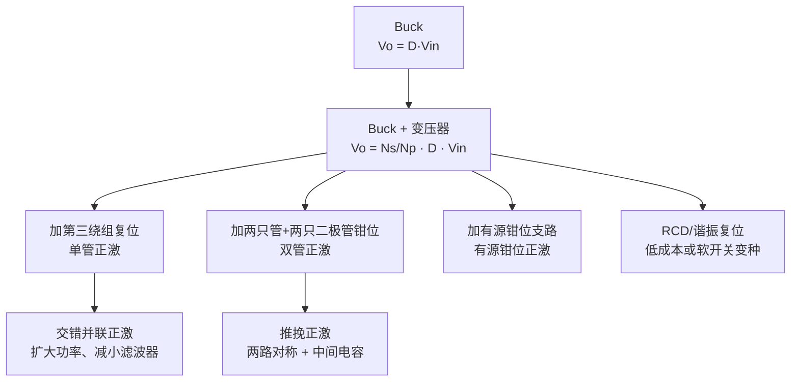

# 正激变换器（Forward Converter）

> **一句话**：正激就是**插了变压器的 Buck**——变压器只负责"传能量 + 变电压 + 隔离"，本身不储能，所以每个开关周期都**必须把磁芯复位**。

## 一、演变：从 Buck 怎么一步步变成正激

### 1.1 原型就是 Buck

$$
V_o = D \cdot V_{in} \quad (0<D<1)
$$

Buck 的缺点：输入输出**共地、无隔离**，而且电压只能靠占空比 D 调，**没有匝比这个自由度**。

### 1.2 插入变压器 → 隔离型 Buck（正激雏形）

把 Buck 的"开关—电感"之间插一个高频变压器，就得到正激的骨架：

$$
V_o = \frac{N_s}{N_p} \cdot D \cdot V_{in}
$$

注意两个自由度分工：

- **匝比 $N_s/N_p$**：定"额定工作点"，决定在标称输入、标称占空比下的电压等级；
- **占空比 $D$**：只负责在工作点附近的**调节**，范围很窄（见 2.4 的 $D_{max}$）。

> 因为输出端仍然是"电感 + 电容"的 LC 滤波，所以**输出电流连续**，这一点和 Buck 完全一样；控制模型也是 Buck 那一套（LC 双极点，CCM 下**没有右半平面零点**），补偿比反激好做。

### 1.3 变压器带来的新矛盾：磁芯必须复位

Buck 的电感可以双向磁化、电流可以反向；但变压器的**励磁电感**不是这样：

- 开关导通时，原边加 $V_{in}$，磁芯磁通 $\Phi$ 一路往上爬；
- 开关关断时，励磁电流**没有回路**，磁通无处可去——如果没有释放路径，剩磁会叠加到下一个周期；
- 几个周期下来 → **磁芯饱和** → 励磁电感塌成几微亨 → 原边电流瞬间冲上去 → **炸管**。

所以正激的"标志性设计"就是**磁复位回路**：保证每个周期结束时，磁通回到出发的那一点。

### 1.4 演变树



同一张 Buck 骨架，**只改"怎么复位"和"用几个开关"**，就派生出整个正激家族。

### 1.5 各分支一句话取舍

| 演变 | 改了什么 | 换来了什么 | 代价 |
| --- | --- | --- | --- |
| 第三绕组复位单管正激 | 多一个 $N_r$ 绕组 + 一只二极管 | 结构简单、效率高、最常见 | 多一个绕组，开关管要扛 $2V_{in}$，$D_{max}=0.5$ |
| RCD 钳位复位 | 用 RCD 把尖峰吃掉 | 省掉第三绕组，成本低 | 复位能量烧在电阻上，效率低、发热 |
| 双管正激 | 原边两只管 + 两只回馈二极管 | 管压降只到 $V_{in}$，无需第三绕组 | 驱动要隔离（上管浮地），$D_{max}=0.5$ |
| 有源钳位正激 | 一个钳位管 + 一个钳位电容 | 复位电压可调，**D 可大于 0.5**，能 ZVS | 多一路驱动、成本高、时序要求严 |
| 谐振（LCD）复位 | 用 $L_m$ 与寄生电容谐振复位 | 无额外绕组、损耗小、$D$ 可略大于 0.5 | 复位电压随条件漂，设计边界窄 |
| 交错并联 / 推挽正激 | 两路正激错开 180° | 功率翻倍、输出纹波频率加倍、滤波器变小 | 两路要均流、驱动更复杂 |

## 二、工作原理（以"单管 + 第三绕组复位"为例）

### 2.1 电路构成

| 器件 | 作用 |
| --- | --- |
| $T$：$N_p$ / $N_s$ / $N_r$ | 原边、副边、复位绕组（通常 $N_r=N_p$，双线并绕） |
| $S$（MOS） | 主开关，占空比 $D$ |
| $D_1$ | 副边整流二极管（导通时传能量） |
| $D_2$ | 副边续流二极管（关断时保输出电流连续） |
| $D_r$ | 复位二极管，只在关断期导通 |
| $L,\ C$ | 输出滤波（Buck 式 LC） |

### 2.2 阶段一：$S$ 导通（$0 \sim DT$）

- **原边**：$N_p$ 上电压 = $V_{in}$，磁通线性上升（$d\Phi = V_{in}dt/N_p$）；原边电流 = 折算到原边的负载电流 + 励磁电流 $i_m$；
- **副边**：$N_s$ 上感应出 $\frac{N_s}{N_p}V_{in}$，$D_1$ 导通、$D_2$ 截止；
- **输出**：电感电压 = $\frac{N_s}{N_p}V_{in}-V_o>0$，电感电流线性上升、储能；
- **复位支路**：$D_r$ 反偏截止（绕向要保证这一点）。

### 2.3 阶段二：$S$ 关断（$DT \sim T$）

- **副边**：副边电压翻号，$D_1$ 截止、$D_2$ 续流，电感电流继续经 $D_2$ 流给负载；
- **原边**：励磁电流经 $N_r$ 和 $D_r$ 把能量**回馈**给 $V_{in}$；原边被钳位在

$$
V_{p,off} = \frac{N_p}{N_r} V_{in}
$$

- 磁通以同样的斜率线性下降，回到起点 → 复位完成；
- **开关管电压**：$V_{ds} = V_{in} + \frac{N_p}{N_r}V_{in}$，取 $N_r=N_p$ 时就是 $\boxed{2V_{in}}$。

### 2.4 伏秒平衡 → 最大占空比

磁通必须每周期归零，即原边"伏秒"正负相等：

$$
V_{in}\cdot D T = \frac{N_p}{N_r}V_{in}\cdot (1-D)T
$$

解得

$$
D_{max} = \frac{n}{1+n},\qquad n=\frac{N_p}{N_r}
$$

- $N_r=N_p$（$n=1$）→ **$D_{max}=0.5$**，工程上取 $D_{max}\approx0.45$ 留裕量；
- 想加大占空比就得让 $N_r<N_p$，但开关管电压应力 $V_{ds}=V_{in}(1+n)$ 会跟着涨——**占空比裕量和电压应力是一对交易**。

> [!warning]
> 如果 $D$ 超过 $D_{max}$（比如输入跌到 36V 以下、环路还在硬撑），复位时间不够，磁通逐周期累加 → 磁芯饱和 → 电流尖峰 → 炸管。正激的**输入最低电压、变压器匝比、$D_{max}$** 是绑在一起算的。

### 2.5 关键波形（时序）

```
S 驱动      ┌────────┐                 ┌────────┐
            │  D·T   │    (1-D)·T      │        │
       ─────┘        └─────────────────┘        └──

V_ds        ┌── Vin  ──┐  ┌── 2Vin（被钳位）──┐
       ─────┘          └──┘                   └──
                    ↑ 关断瞬间漏感尖峰（RCD/RC 吸收）

副边电压     ┌ (Ns/Np)Vin ┐  ┌─ (Ns/Nr)Vin ─┐
       ─────┘            └──┘               └──

输出电感电流      /‾‾‾‾\      /‾‾‾‾\
       ─────────/      \────/      \────── 连续（Buck 式三角波）

励磁电流 i_m      /‾‾\          /‾‾\
       ─────────/    \────────/    \────── 每周期回到 0
```

- **副边 $D_1$ 反向电压**：$\frac{N_s}{N_r}V_{in}$（$N_r=N_p$ 时为 $\frac{N_s}{N_p}V_{in}$）；
- 励磁电流每个周期都归零（对励磁而言是 DCM），**输出电感**则按负载可能 CCM/DCM。

### 2.6 公式汇总

| 量 | 表达式 | 备注 |
| --- | --- | --- |
| 输出电压 | $V_o=\frac{N_s}{N_p}DV_{in}$ | 忽略二极管压降、CCM |
| 最大占空比 | $D_{max}=\frac{n}{1+n}$，$n=N_p/N_r$ | $n=1$ 时 0.5 |
| 开关管应力 | $V_{ds}=V_{in}(1+n)$ | 单管；双管为 $V_{in}$ |
| 复位时间 | $T_{reset}=\frac{N_p}{N_r}DT$ | 必须 $\le (1-D)T$ |
| 磁通摆幅 | $\Delta B=\frac{V_{in}DT}{N_pA_e}$ | 单向磁化，$\Delta B$ 决定损耗 |
| 励磁电流 | $i_m(t)=\frac{V_{in}}{L_m}t$ | 峰值 $=\frac{V_{in}DT}{L_m}$ |
| 电感纹波 | $\Delta I_L=\frac{\left(\frac{N_s}{N_p}V_{in}-V_o\right)DT}{L}$ | 同 Buck |

### 2.7 一个算例

$V_{in}=36\sim72\text{ V}$，$V_o=12\text{ V}/5\text{ A}$，取 $N_p:N_s=1:1$：

- 最低输入时 $D=\frac{12}{36}=0.33<0.45$ ✓（最高输入时 $D=0.167$）
- 开关管应力 $2V_{in,max}=144\text{ V}$ → 选 200V MOS
- 副边二极管反压 $\approx\frac{N_s}{N_p}V_{in,max}=72\text{ V}$ → 选 100V 肖特基/快恢复
- 复位绕组取 $N_r=N_p$，与 $N_p$ 双线并绕

### 2.8 磁芯是怎么工作的

- **单向磁化**：磁通只在 $B\text{-}H$ 回线的**第一象限**来回摆（$0 \to B_{max} \to 0$），不像推挽/桥式那样正负对称利用；
- 所以磁芯利用率低、同样功率下比双向磁化的拓扑大一点；
- 但也正因为单向，**磁芯只需要处理励磁能量**（几十分之一到百分之几的额定功率），比反激"存全部能量"的变压器小得多。

## 三、磁复位方式对比

| 复位方式 | 复位电压（原边） | $D_{max}$ | 开关应力 | 效率 | 复杂度 |
| --- | --- | --- | --- | --- | --- |
| 第三绕组复位 | $V_{in}$ | 0.5 | $2V_{in}$ | 高 | 低（多绕组） |
| RCD 钳位 | $V_{in}+V_{clamp}$ | <0.5 | 略高于 $2V_{in}$ | 低（能量烧掉） | 最低 |
| 双管正激 | $V_{in}$（两只二极管钳位） | 0.5 | $V_{in}$ | 高 | 中（隔离驱动） |
| 有源钳位 | 可调，$V_c\approx\frac{D}{1-D}V_{in}$ | **>0.5** | $V_{in}+V_c$ | 很高（ZVS） | 高 |
| 谐振（LCD） | 由 $L_m$、$C$ 谐振决定 | ≈0.5~0.6 | 略高于 $2V_{in}$ | 高 | 中 |

> 选型直觉：**几十到 200W 看成本 → RCD/绕组复位；200W~500W 主流 → 双管正激；要软开关、宽输入、高效率 → 有源钳位正激。**

## 四、设计 / 易错点

1. **匝比 + $D_{max}$ + 最低输入电压**必须一起算，别先定匝比再回头怪占空比不够；
2. **复位绕组同名端接反 = 不复位**：表现为空载也炸管、$V_{ds}$ 直接顶到母线以上；调试先看 $V_{ds}$ 波形是不是稳定在 $2V_{in}$；
3. 复位绕组与 $N_p$ **双线并绕**，减小漏感，否则关断尖峰吃掉裕量；
4. **漏感尖峰**要 RC/RCD 吸收（与"复位"不是一回事：复位管的是**励磁**能量，吸收管的是**漏感**能量）；
5. 副边**同步整流**能把 12V 以下输出的效率拉回来，但要注意 $D_1/D_2$ 的死区与反灌；
6. 输出电感按 Buck 公式设计，但**占空比分辨率**要求更高（$D$ 只有 0.15~0.45 这段可用）；
7. 双管正激的**上管必须隔离驱动**（或自举/变压器驱动），且两只管要严格同步关断。

## 五、正激 vs 反激 vs Buck

| 对比项 | Buck | 正激 | 反激 |
| --- | --- | --- | --- |
| 原型 | — | Buck + 变压器 | Buck-Boost + 变压器 |
| 能量传递 | 导通时传 | 导通时传（**正向**） | 关断时传（先存后放） |
| 变压器作用 | — | 传能量、变压、隔离 | **储能** + 变压 + 隔离 |
| 变压器体积 | — | 小（只处理励磁能量） | 大（存全部能量） |
| 输出电流 | 连续 | **连续**（LC 滤波） | 断续（脉动，纹波大） |
| 右半平面零点 | 无 | 无 | **CCM 下有**，补偿受限 |
| 副边二极管 | 1 只 | 2 只（整流 + 续流） | 1 只 |
| 占空比上限 | 1 | 0.5（单管/双管） | 不限（受应力限制） |
| 功率范围 | 任意 | 数十 W ~ 几百 W | 数十 W ~ 100W |
| 典型用途 | 板载降压 | ATX 辅助/通信/工业电源 | 充电器、小功率适配器 |

## 六、优缺点与应用

**优点**

- 输出电流连续、纹波小、滤波好做；
- 变压器只传能量不储能，体积小、铜损低；
- 控制模型同 Buck（无 RHP 零点），环路好补偿；
- 磁芯单向磁化、无偏磁问题，变压器绕制不用像推挽/桥式那样苛求对称。

**缺点**

- 每次都得"复位"，多了绕组/钳位电路；
- 磁芯单向磁化，利用率低；
- 单管 $D_{max}=0.5$、$V_{ds}=2V_{in}$，输入范围与耐压互相挤压；
- 双管要隔离驱动，有源钳位成本高。

**典型应用**：100~300W（双管可到 400~500W）的通信电源、工业电源、ATX 辅助电源、电池充电器前级、服务器辅助轨。

## 七、自测

1. 为什么正激不用像反激那样"变压器储能"？这对磁芯选型意味着什么？
2. $N_r=N_p$ 时开关管为什么扛 $2V_{in}$？如果改成 $N_r=2N_p$，$D_{max}$ 和 $V_{ds}$ 各变成多少？
3. 关断时漏感尖峰和励磁复位是同一件事吗？各自的能量去哪里了？
4. 双管正激相比单管，为什么能省掉第三绕组、还能把应力降到 $V_{in}$？
5. 有源钳位为什么能把 $D$ 做到 0.5 以上？代价是什么？

## 参考

- 原文（知乎专栏）：<https://zhuanlan.zhihu.com/p/7667983500>
- 正激 / 正激电路（百度百科）：<https://baike.baidu.com/item/正激/9907757>
- 开关电源拓扑演变与汇总：<https://www.eet-china.com/mp/a11710.html>
- 相关笔记：[[开关电源--DCDC]]、[[反激电源]]、[[开关电源控制模式]]、[[反馈回路]]
